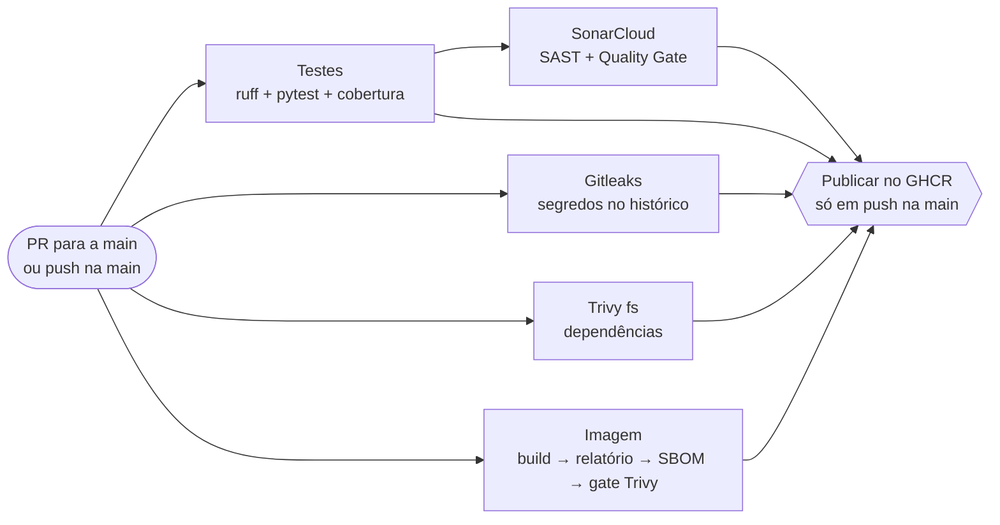

# ufla-devops-shop

Repositório da turma de **DevOps na Prática** — DCC / UFLA.

Prof. Dr. Rafael Serapilha Durelli · [rafael.durelli@ufla.br](mailto:rafael.durelli@ufla.br)

Este repositório é o **projeto fio condutor** da disciplina. Você faz um *fork*
dele na Atividade 0 e trabalha no seu fork durante as 15 semanas: a mesma
aplicação vai sendo containerizada, testada, empacotada, implantada, monitorada
e provisionada, semana após semana.

---

## Trabalho Prático — Pipeline DevSecOps com GitHub Actions

> Fork de **Gabriel Barros Ferreira** (`GabrielBarrosFerreira`) · DevOps na Prática, 2026/2 · Aula 8 — *shift-left security*

Todo Pull Request para a `main` e todo push na `main` passam pela esteira
[`.github/workflows/devsecops.yml`](.github/workflows/devsecops.yml). Nenhuma
mudança entra na `main` — e nenhuma imagem é publicada — sem passar por
segredos (Gitleaks), SAST (SonarCloud), SCA nas dependências e na imagem (Trivy)
e inventário de componentes (SBOM com Syft).



### Ferramentas, verificações e regras de bloqueio

| Check obrigatório | Ferramenta | O que verifica | Bloqueia quando |
|---|---|---|---|
| `Gitleaks (segredos no historico)` | Gitleaks 8.30.1 | Cada commit da história até o commit avaliado — num PR, toda a `main` mais os commits do PR | **Qualquer** segredo encontrado (senha, token, chave) |
| `SonarCloud (SAST e Quality Gate)` | SonarQube Cloud | Código Python (`app/`) e front (`static/`), com a cobertura do pytest | Quality Gate **Sonar way** reprovado no **código novo** (problema novo de segurança ou confiabilidade, *security hotspot* não revisado, cobertura ou duplicação fora do limite) |
| `Trivy (dependencias)` | Trivy 0.70 (`trivy fs`) | Dependências declaradas em `requirements*.txt` | CVE **CRITICAL ou HIGH com correção disponível** |
| `Imagem (build, Trivy e SBOM)` | Docker + Trivy (`trivy image`) + Syft | Pacotes do Alpine e bibliotecas Python **dentro da imagem** | Mesma regra do Trivy; o SBOM é artefato e nunca bloqueia |
| `Testes (lint, pytest e cobertura)` | ruff + pytest + pytest-cov | Gate de qualidade da semana 7 | Lint ou teste falhando |

**LOW e MEDIUM — e CVEs sem correção publicada — não bloqueiam:** ficam
registradas no relatório completo do Trivy (resumo da execução e artifacts
`relatorio-trivy-dependencias` e `relatorio-trivy-imagem`). Exceção pontual só
pelo [`.trivyignore`](.trivyignore), com justificativa, responsável e data de
revisão — nunca com `exit-code: 0`.

**Publicação:** o job `Publicar imagem no GHCR` depende de **todos** os checks
acima e só roda em push na `main`. Ele publica a **mesma imagem** que foi
construída e verificada no job `imagem` (salva como artifact), em
`ghcr.io/gabrielbarrosferreira/ufla-devops-shop:sha-<commit>` — tag imutável.

**Proteção da `main`** (ruleset `proteger-main`): Pull Request obrigatório, os
cinco checks acima obrigatórios, sem *force push*, sem deleção da branch e sem
*bypass*.

### Onde ver cada resultado

| O quê | Onde |
|---|---|
| Execuções da esteira | Aba **Actions** → workflow `DevSecOps CI/CD` |
| Relatório completo do Trivy | Resumo (*Summary*) de cada execução + artifacts `relatorio-trivy-*` |
| SBOM (SPDX JSON) | Artifact `sbom-ufla-shop.spdx.json` de cada execução |
| Análise estática | [SonarCloud — código novo](https://sonarcloud.io/summary/new_code?id=GabrielBarrosFerreira_ufla-devops-shop) |
| Imagens publicadas | [Pacote no GHCR](https://github.com/users/GabrielBarrosFerreira/packages/container/package/ufla-devops-shop) |
| PRs de demonstração | [Pull Requests deste fork](https://github.com/GabrielBarrosFerreira/ufla-devops-shop/pulls?q=is%3Apr) |

### Demonstração do bloqueio e da correção (Requisito 5)

1. **PR `teste-cve`** — adiciona `urllib3==1.26.4`, versão com CVEs HIGH
   conhecidas e com correção (ex.: CVE-2021-33503, corrigida na 1.26.5;
   CVE-2023-43804, corrigida na 1.26.17). Os checks `Trivy (dependencias)` e
   `Imagem (build, Trivy e SBOM)` falham e o merge fica bloqueado.
2. **Correção no mesmo PR** — `urllib3==2.8.0` (sem CVE conhecida). Todos os
   checks passam e o merge é liberado. A versão vulnerável nunca chegou à
   `main` nem ao GHCR.
3. **PR `teste-gitleaks`** — chave de API **falsa**, gerada aleatoriamente. O
   Gitleaks bloqueia; o PR foi fechado sem merge e a branch, apagada.

### Decisões de projeto (o porquê)

- **`urllib3==1.26.4` em vez do `requests==2.19.1` sugerido em aula.** O
  requests 2.19.1 exige `idna<2.8`, mas FastAPI → Starlette → AnyIO exige
  `idna>=2.8`: o pip não encontra combinação possível e o build quebraria por
  conflito de dependências — não pela segurança. O urllib3 é o motor HTTP do
  próprio requests e instala sem conflito, então a falha observada é
  exclusivamente a do gate.
- **Actions fixadas por SHA de commit.** Em 19/03/2026, 76 das 77 tags da
  `aquasecurity/trivy-action` foram reapontadas para código que roubava
  credenciais ([CVE-2026-33634](https://github.com/aquasecurity/trivy/security/advisories/GHSA-69fq-xp46-6x23));
  a `@0.28.0` está no intervalo afetado. A `SonarSource/sonarqube-scan-action`
  v4 tem duas falhas HIGH de injeção (corrigidas na 5.3.1 e na 6.0.0). Por
  isso: versões corrigidas e `uses: dono/action@<sha> # vX.Y.Z`. O Gitleaks é
  baixado em versão fixa e conferido por checksum.
- **Construa uma vez, publique a mesma.** A imagem verificada pelo Trivy é
  exatamente a imagem publicada — nada é reconstruído depois do gate.
- **`apk upgrade` no Dockerfile.** O gate só bloqueia CVE com correção
  disponível; atualizar os pacotes do Alpine no build aplica essas correções e
  ataca a causa mais comum de bloqueio vinda da imagem base.
- **Por que LOW/MEDIUM não bloqueiam.** Um gate que barra tudo vira ruído, e a
  equipe aprende a ignorá-lo — inclusive o CRITICAL de verdade. Começa-se
  bloqueando pouco e aperta-se a régua com o tempo.
- **Segredos.** O único segredo de longa duração é o `SONAR_TOKEN` (GitHub
  Secrets). A publicação usa o `GITHUB_TOKEN` efêmero do job, com
  `packages: write` apenas no job `publicar`; o padrão é `contents: read`.

### Reproduzir localmente

```bash
gitleaks git . --redact -v                                   # segredos em todo o histórico
trivy fs --scanners vuln --severity CRITICAL,HIGH --ignore-unfixed --exit-code 1 .
docker build -t ufla-shop:local .
trivy image --severity CRITICAL,HIGH --ignore-unfixed --exit-code 1 ufla-shop:local
syft ufla-shop:local -o spdx-json > sbom.spdx.json           # SBOM
```

> O workflow `Atividade 0` (corretor automático do repositório do professor)
> fica desabilitado neste fork: ele só faz sentido no repositório da turma.

---

## Comece por aqui

1. Instale as ferramentas: **[docs/instalacao.md](docs/instalacao.md)**
   (Ubuntu/Debian, Fedora, macOS e Windows com WSL2).
2. Faça o *fork* deste repositório (botão **Fork**, canto superior direito).
3. Clone o **seu** fork e verifique a máquina:

   ```bash
   git clone git@github.com:<seu-usuario>/ufla-devops-shop.git
   cd ufla-devops-shop
   ./scripts/check-ambiente.sh
   ```

4. Siga o enunciado da **Atividade 0**, publicado no campus virtual.

---

## Estrutura

```
ufla-devops-shop/
├── app/                       # a API (FastAPI): uvicorn app:api
├── static/                    # o front estático, servido pela API em /
├── tests/                     # pytest — roda sem banco nem cache
├── requirements.txt           # dependências de execução (vão para a imagem)
├── requirements-dev.txt       # + testes, cobertura e lint (CI e desenvolvimento)
├── pyproject.toml             # configuração de ruff, pytest e cobertura
├── docs/
│   ├── instalacao.md          # roteiro de instalação por sistema operacional
│   └── aplicacao.md           # como a aplicação funciona, rotas e variáveis
├── scripts/
│   ├── check-ambiente.sh      # verificador de ambiente (Atividade 0)
│   └── baixar-dados.sh        # traz o access.log da Atividade 2
├── alunos/                    # apresentação de cada aluno (Atividade 0)
├── analises/                  # análises da Atividade 1 e (em logs/) da Atividade 2
└── .github/
    ├── pull_request_template.md
    └── workflows/             # verificação automática de cada atividade
```

## A aplicação

`ufla-devops-shop` é uma loja mínima: API em Python (FastAPI), PostgreSQL,
Redis e um front estático. Ela é o **fio condutor** das 15 semanas — cada
atividade acrescenta uma camada sobre a mesma base, e nenhuma começa do zero.

```bash
python3 -m venv .venv && source .venv/bin/activate
pip install -r requirements-dev.txt
uvicorn app:api --reload        # http://localhost:8000  (API + front + /docs)
pytest --cov=app                # os testes não precisam de banco nem de cache
```

Sem variáveis de ambiente ela sobe **sozinha** (SQLite + cache em memória).
Com `DATABASE_URL` e `REDIS_URL` ela usa PostgreSQL e Redis. Rotas, variáveis,
modos e os tamanhos reais de imagem estão em
**[docs/aplicacao.md](docs/aplicacao.md)** — leia antes da Atividade 4.

### Seu fork está desatualizado?

Quem fez o *fork* antes de a aplicação entrar aqui precisa **trazê-la**:
`git pull` puxa do seu fork, não deste repositório.

```bash
git remote add upstream https://github.com/rdurelli/ufla-devops-shop.git   # uma vez só
git fetch upstream && git switch main && git merge upstream/main && git push origin main
```

Ou **Sync fork → Update branch** na página do seu fork. Faça isso no início de
**toda** atividade.

## `scripts/check-ambiente.sh`

Verifica ferramentas, versões mínimas, o daemon do Docker, a configuração do Git
e os recursos da máquina. Quando algo falta, imprime o comando de instalação
para o sistema detectado.

```bash
./scripts/check-ambiente.sh                      # relatório colorido
./scripts/check-ambiente.sh | tee ambiente.txt   # salva para anexar ao PR
```

Sai com código `0` se o ambiente estiver pronto e `1` se faltar algo
obrigatório. Versões mínimas: `git` 2.30, `docker` 24.0, `kubectl` 1.28,
`kind` 0.20, `helm` 3.12, `terraform` 1.5, Docker Compose v2.

O script também é material didático: na Semana 4 (shell script) abrimos este
arquivo em aula e discutimos as construções usadas nele.

---

## Como entregar

Toda atividade tem **duas etapas obrigatórias**. Faltando qualquer uma delas, a
atividade é considerada não entregue.

1. **Pull Request neste repositório**, com o trabalho feito na *branch*
   `atividade-NN` do seu fork.
2. **Link do Pull Request postado no campus virtual**, na tarefa correspondente.
   O horário desta postagem é o registro oficial da entrega.

O fluxo é sempre o mesmo:

```bash
git switch -c atividade-00                       # branch da atividade
git add alunos/<seu-usuario>.md ambiente.txt     # seus arquivos
git commit -m "feat: apresentacao e ambiente de <seu-usuario>"
git push -u origin atividade-00
```

Depois abra o Pull Request pelo GitHub, com o título no padrão
`Atividade 0 -- Seu Nome`.

### Verificação automática

Assim que o PR é aberto, o GitHub Actions roda sozinho e comenta o resultado em
cerca de um minuto. Se aparecer ✗ vermelho, leia o comentário, corrija, faça um
novo commit e dê `push` na mesma branch — o PR se atualiza sozinho. Você pode
repetir isso quantas vezes quiser antes do prazo.

A verificação automática **não é a nota**. Ela cobre o que a máquina consegue
julgar; a avaliação do professor complementa nos aspectos que ela não julga —
clareza, justificativa das decisões e qualidade da documentação.

### Atrasos e descarte

Atraso: desconto de 1,0 ponto por dia corrido, contado pelo horário da postagem
no campus virtual. Descarte: a menor nota entre as atividades do semestre é
descartada no cálculo final, sem necessidade de justificativa.

---

## Onde pedir ajuda

No **fórum da atividade**, no campus virtual. Pergunta pública gera resposta que
serve para a turma toda — e quase sempre alguém já passou pelo mesmo problema.

Ao relatar um erro, inclua:

1. o que você estava tentando fazer;
2. o comando exato que executou;
3. a mensagem de erro **completa**, copiada como texto (não como foto da tela);
4. o que você já tentou.

Esta é a mesma estrutura de um bom *issue* e de um bom *postmortem*.

---

## Uso de IA generativa

Permitido e incentivado. Em contrapartida, você deve ser capaz de explicar
qualquer linha entregue: a arguição final pergunta o *porquê* das decisões, não
a sintaxe.
